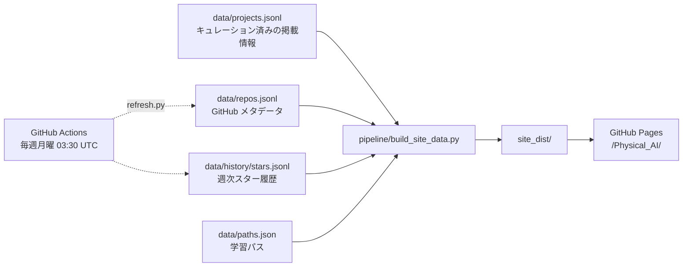

# Physical AI Radar

**論文・実装・動作条件を、ひとつの地図に。**
Physical AI の技術を、研究カテゴリと実装用途の両方から探せる静的カタログです。

[](https://github.com/agilealpha1/Physical_AI/actions/workflows/pages.yml)
[](https://agilealpha1.github.io/Physical_AI/)
[](LICENSE)
[](DATA_LICENSE.md)

> 公開 URL は GitHub Pages 有効化後の想定です: **https://agilealpha1.github.io/Physical_AI/**

---

## これは何か

Physical AI の情報は、論文・GitHub・モデルカード・シミュレータのドキュメントに分散しています。
スター数だけでは「自分の機体で動くか」「どの GPU が必要か」「実機で確認されているか」は分かりません。

Physical AI Radar は、次の問いに答えるために作りました。

- この技術は **何ができるのか**
- 論文・コード・重み・データは **どこにあるのか**
- 実際に動かすには **何が必要なのか**
- シミュレーション / 開発元の実機 / 第三者の再現の、どこまで **確認されているのか**

**不明な項目は空欄にせず「未確認」と表示**し、AI による推測値は掲載しません。

## 初版のスナップショット

| 項目 | 値 |
|---|---:|
| 掲載技術 | **111** |
| 技術カテゴリ | **5** |
| 用途タグ | **6** |
| 代表論文リンク | **97**（96 件が論文付き） |
| 開発元の実機評価を確認 | **11** |
| シミュレーション評価を確認 | **13** |
| データ最終取得 | 2026-11-14（JST） |
| スタースナップショット | 1 回（週次増加は計測中） |

初版 47 件に、[Awesome Physical AI](https://github.com/keon/awesome-physical-ai) に掲載されたコード付きプロジェクトのうち GitHub リポジトリの存在を確認できた 64 件を追加しました。今回追加した項目の動作条件・検証・ライセンスは未確認です。スター数・Fork 数・最終 push 日は初回の GitHub API 取得待ちです。
スター数は掲載条件にせず、並び替えと参考指標にだけ使っています。

## 画面

| ルート | 内容 |
|---|---|
| `#/` | ホーム。カテゴリ、注目の実装、実機評価の状況、最近の更新、学習パス |
| `#/browse` | 検索・絞り込み・並び替え。カテゴリ / 用途 / 検証条件 / 重み・データ公開でフィルタ |
| `#/p/<id>` | 詳細。できること、動作条件、検証状況、公開条件、論文、出典、関連技術 |
| `#/compare?ids=a,b` | 最大 4 件の横並び比較。動作条件・検証・ライセンスを同じ表で確認 |
| `#/paths` | 目的別の学習パス。プロジェクトと論文を順番につなぐ |
| `#/about` | 掲載基準、検証の定義、更新と公開の分離、ライセンス |

検索条件は URL のハッシュに残ります。比較リストとテーマは `localStorage` に保存します
（キーは `physical-ai:compare` / `physical-ai:theme`）。

## 設計

既存の SkillStars / LangStars / HackerPapers と同じ **Python → 静的 JSON → HTML/CSS/JS → GitHub Pages** の構成です。
サーバーもデータベースもフレームワークも不要です。



| 層 | ファイル | 役割 |
|---|---|---|
| キュレーション | `data/projects.jsonl` | 日本語要約、できること、動作条件、検証、ライセンス、公式リンク |
| メタデータ | `data/repos.jsonl` | GitHub の stars / forks / 最終 push / topics / ライセンス |
| 履歴 | `data/history/stars.jsonl` | ISO 週ごとのスター数。初回は 1 点のみ |
| 学習パス | `data/paths.json` | 目的別の 6 ステップと論文 |
| 取得 | `pipeline/refresh.py` | GitHub REST API。失敗時は前回値を保持 |
| 検証 | `pipeline/validate.py` | スキーマ、URL、分類、パス参照、ライセンス表記を検査 |
| 生成 | `pipeline/build_site_data.py` | 一覧 JSON、詳細 JSON、RSS、オープンデータ zip、サイトを生成 |
| 画面 | `site/index.html` / `app.js` / `style.css` | ハッシュルーティングの SPA。相対パスで `/Physical_AI/` に対応 |

### データモデル（抜粋）

```json
{
  "id": "groot",
  "name": "Isaac GR00T",
  "full_name": "NVIDIA/Isaac-GR00T",
  "category": "robot-learning",
  "uses": ["humanoid", "arm", "warehouse"],
  "summary": "NVIDIA のヒューマノイド向け VLA 基盤モデル。",
  "body": "学習から TensorRT 展開までを提供する。",
  "fit": "ヒューマノイドや双腕機の操作ポリシーを試すとき。",
  "caveat": "推論 16GB+、微調整 40GB+ 推奨。",
  "requirements": {
    "os": {"value": "Linux（Ubuntu）/ JetPack", "status": "official"},
    "gpu": {"value": "NVIDIA GPU（RTX 4090 / L40 / H100 / Jetson）", "status": "official"},
    "vram": {"value": "推論 16GB+ / 微調整 40GB+ 推奨", "status": "official"},
    "robot": {"value": "ヒューマノイド G1、双腕機", "status": "official"},
    "sim": {"value": "RoboCasa / SimplerEnv", "status": "official"},
    "runtime": {"value": "Python 3.12 / CUDA 12.8（dGPU）", "status": "official"}
  },
  "verification": {
    "sim": "reported",
    "real": "vendor",
    "repro": "official",
    "evidence": [{"label": "論文", "url": "https://arxiv.org/abs/2503.14734"}],
    "note": "N1.7 は実機 G1 と RoboCasa / SimplerEnv の結果を報告。"
  },
  "licenses": {
    "code": {"value": "Apache-2.0", "status": "official"},
    "weights": {"value": "NVIDIA Open Model License", "status": "official"},
    "data": {"value": "学習データの条件に従う", "status": "varies"}
  }
}
```

`status` は `official` / `community` / `unknown` / `na`（動作条件）、
`official` / `varies` / `unknown` / `na`（ライセンス）です。
`unknown` は画面で「未確認」と表示されます。

## ローカルで動かす

Python 3.10+（CI は 3.12）と `requests` だけが必要です。

```bash
git clone https://github.com/agilealpha1/Physical_AI.git
cd Physical_AI

python3 -m venv .venv
source .venv/bin/activate
pip install -r requirements.txt

make build        # data/ から site_dist/ を生成
make serve        # http://localhost:8000/
make test         # 13 unit tests
```

`make build` は API を呼びません。コミット済みのデータだけでサイトが作れます。

### データを更新する

```bash
export GITHUB_TOKEN="$(gh auth token)"   # 任意。付けるとレート制限が緩くなる
make refresh                             # repos.jsonl / stars.jsonl / meta.json を更新
make build
```

`refresh.py` は 111 リポジトリを取得し、同じ ISO 週のスナップショットを置き換えます。
80% 未満しか取得できなかった場合は中断し、既存データを残します（`--force` で解除）。
一部だけ失敗した場合は、そのリポジトリの前回値を使ってスナップショットの穴を埋めます。

## GitHub Pages への公開

1. 通常はワークフロー内の `actions/configure-pages` が Pages を有効化します（`enablement: true`）。
   組織ポリシーなどで失敗する場合は、**Settings → Pages → Build and deployment → Source** を **GitHub Actions** にしてください。
2. `main` に push すると `.github/workflows/pages.yml` が走ります。
3. 初回は **Actions** タブで `Refresh data and deploy Pages` の完了を確認します。
4. **https://agilealpha1.github.io/Physical_AI/** が公開 URL です。

ワークフローの動き:

- `push`: データ更新はせず、コミット済みデータでビルド・公開
- `schedule`（毎週月曜 03:30 UTC）: `refresh.py` → テスト → ビルド → 公開
- `workflow_dispatch`: `refresh_data` を true にすると手動更新

**データ更新に失敗しても、前回のデータでサイト公開は継続**します。
そのため画面の「データ最終取得」は、サイトを再公開した日時ではなく、GitHub から最後に正常取得できた日時を表示します。

> 初回公開時は Pages の Source が GitHub Actions になっていないと deploy ジョブが失敗します。
> リポジトリ設定を先に確認してください。

## 掲載を追加・修正する

1. `data/projects.jsonl` に 1 行追加、または既存行を編集します。
2. `full_name` を `data/projects.jsonl` と GitHub の実リポジトリに合わせます。
3. `python pipeline/refresh.py --force` でメタデータを取得します。
4. `python pipeline/validate.py` と `make test` を通します。
5. `make build` で表示を確認し、PR を出します。

必須に近い項目:

- 日本語の `summary` / `body` / `fit` / `caveat`
- 公式の `links.github`、可能なら `docs` / `paper` / `weights` / `data` / `demo`
- `requirements` の 6 項目（不明なら `未確認` + `unknown`）
- `verification` の 3 項目と、最低 1 つの `evidence`
- `licenses` のコード・重み・データと、`license_source`
- `checked_at`（サイト側で確認した日）

スター数は `projects.jsonl` に書きません。`repos.jsonl` の取得値を使います。

## 掲載基準

- Physical AI の研究・実装・運用に直接関係する公式プロジェクト
- GitHub リポジトリ、論文、ドキュメントのうち一次情報が確認できる
- スター数は掲載条件にしない
- 不明な項目は推測で埋めず「未確認」と表示する

## 検証状況の定義

| 項目 | 値 | 意味 |
|---|---|---|
| Simulation | `reported` / `not_reported` / `na` / `unknown` | 論文・公式コードにシミュレーション評価の記載があるか |
| Real robot | `vendor` / `third_party` / `community` / `not_reported` / `na` / `unknown` | 誰が実機で確認したか。開発元とコミュニティを分ける |
| Reproduction | `official` / `third_party` / `not_reported` / `na` / `unknown` | 第三者が再現できるコード・手順・重みがあるか |

初版では `repro` は「公式コード・手順あり」が中心で、第三者の独立再現までは確認できていないものが多くあります。
確認でき次第 `third_party` に更新します。

## 既知の制約

- 初版 47 件はキュレーションの出発点で、分野全体を網羅していません。
- Awesome Physical AI 由来の追加 64 件は、GitHub リポジトリの存在のみ確認しています。動作条件・ライセンス・検証状況と GitHub メタデータの初回取得は未確認です。
- [BenchLM の RoboDojo Sim](https://benchlm.ai/benchmarks/robodojosim) は外部のベンチマーク報告として参照しています。BenchLM は 5 件の結果をすべて提供元報告として扱い、公開ハーネスのない結果は再現可能な評価として数えていません。
- 動作条件は公式ドキュメントの記載を要約したものです。依存バージョン、ドライバ、機体差は各自で確認してください。
- スター数は GitHub Search / REST API の値をそのまま使います。取得時刻は `data/meta.json` に残ります。
- スターの週次増加は、2 回目以降のスナップショットから表示されます。初版は「計測中」です。
- 論文は各プロジェクトの代表論文に限定しています。HackerPapers のような大規模論文 DB ではありません。
- 自動運転・運転支援・ロボットの実機利用は、法規・安全審査・現場のリスク評価に従ってください。

## ライセンス

- **コード**: [MIT](LICENSE)
- **キュレーション済みデータ**: [CC0 1.0](DATA_LICENSE.md)
- **各プロジェクト**: コード・重み・データごとに異なります。詳細ページの「公開条件」と公式リポジトリを確認してください。
- **Fuse.js**: Apache-2.0（`site/vendor/FUSE_LICENSE`）。

GitHub のメタデータ、論文タイトル、README 由来の情報は各著作者に帰属します。
